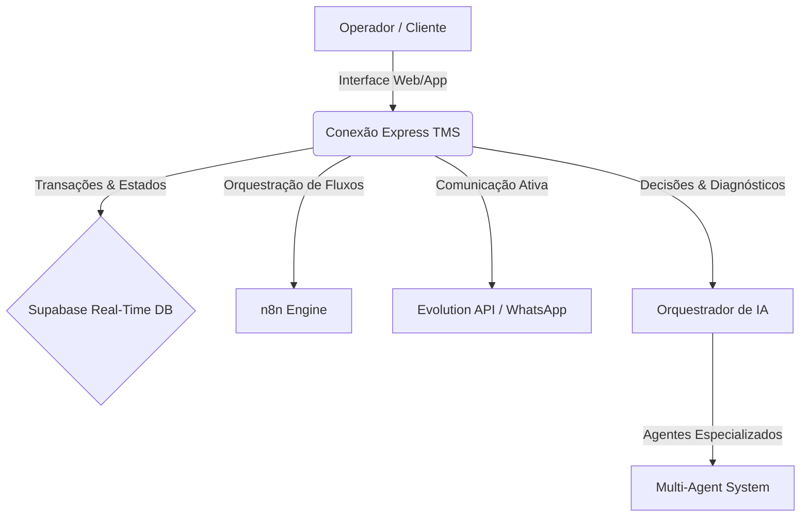
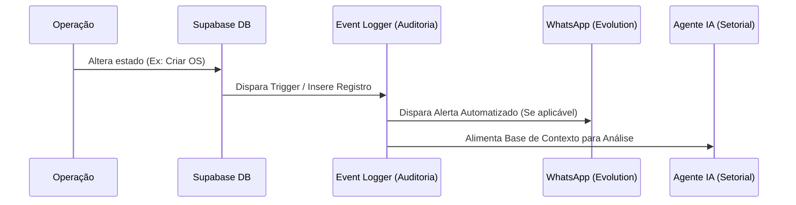

# VISÃO GERAL DO TMS INTELIGENTE & SEMI-AUTÔNOMO — CONEXÃO EXPRESS

Este documento define a visão estratégica, arquitetura conceitual e diretrizes de desenvolvimento para transformar o **Conexão Express TMS** em um sistema logístico de padrão mundial, inteligente e semi-autônomo, eliminando a necessidade de processos puramente manuais e habilitando tomadas de decisão guiadas por dados e inteligência artificial.

---

## 1. VISÃO GERAL

O objetivo final do **Conexão Express TMS** é consolidar-se como um **Sistema Operacional Real** (sem mocks ou dependências locais isoladas) voltado para a operação profissional e de alto rendimento de transportadoras modernas.



### Características Fundamentais:
- **Sistema Operacional Real:** Integração ponta a ponta com banco de dados real em produção (Supabase), sem dependência de estados fictícios, locais (`localStorage`) ou mockados.
- **Inteligente:** Não apenas armazena registros, mas analisa tendências, sugere otimizações e detecta desvios preventivamente.
- **Semi-Autônomo:** Executa rotinas repetitivas de forma autônoma (como faturamento, cobrança de documentos e alertas de atrasos), mas mantém o operador humano integrado (*human-in-the-loop*) para aprovações financeiras críticas e decisões estratégicas de contingência.
- **Integrado:** Comunicação nativa entre CRM comercial, roteirização geoespacial (Mapbox), ERP financeiro, mensageria instantânea (WhatsApp/Evolution API), barramento de automação (n8n), e governança de documentos.
- **Escalável:** Arquitetura *multi-tenant* robusta, com baixo acoplamento entre os componentes e lógica de renderização desacoplada de regras de negócio.
- **IA por Setor:** Divisão de tarefas cognitivas complexas entre múltiplos agentes inteligentes, reduzindo gargalos operacionais e otimizando margens de lucro.

---

## 2. PILARES DO SISTEMA INTELIGENTE

O ecossistema é sustentado por 17 pilares integrados que moldam a inteligência do sistema:

1. **Torre de Controle Inteligente:** Telemetria centralizada em tempo real com regras de cerca virtual (*geofencing*), estimativa dinâmica de horário de chegada (ETA) e identificação imediata de desvios de rota.
2. **Escala Operacional Inteligente:** Algoritmo dinâmico que cruza a disponibilidade dos prestadores, tipo de veículo, pontuação de reputação, região de atuação e histórico operacional para propor as melhores alocações de viagem.
3. **OS/OC Automática:** Conversão instantânea de propostas e orçamentos aprovados no Comercial em Ordens de Serviço (OS) e Ordens de Carregamento (OC), herdando tabelas de frete contratadas sem digitação manual.
4. **Financeiro Automático:** Geração automática de contas a pagar (repasses a prestadores) e contas a receber (faturamento a clientes), conciliação bancária inteligente via CNAB/Open Finance e fluxo de caixa projetado.
5. **Roteirização Inteligente:** Algoritmo de roteamento baseado em Mapbox que minimiza custos logísticos, otimiza pedágios, evita áreas de risco e maximiza o aproveitamento da frota.
6. **Gestão de Prestadores:** Funil de homologação robusto com verificação documental automatizada (Score Documental) e classificação dinâmica por performance e fidelidade.
7. **App Prestador Inteligente:** Aplicativo responsivo focado no motorista, permitindo atualização de status em tempo real, registro de ocorrências com fotos, digitalização inteligente de comprovantes e comunicação offline com sincronização posterior.
8. **Portal Cliente Premium:** Área de autoatendimento para clientes corporativos realizarem solicitações de frete, acompanharem suas mercadorias no mapa, realizarem downloads de comprovantes (POD) e visualizarem faturas em aberto.
9. **WhatsApp Operacional Automático:** Canal conversacional acionado via Evolution API para aviso de escalas, cobrança de documentação expirada, alertas de trânsito e envio de atualizações ao cliente final.
10. **n8n como Orquestrador:** Motor de workflows de segundo plano responsável por sincronizar sistemas de terceiros, processar webhooks rápidos e gerenciar tarefas temporizadas sem sobrecarregar a thread principal da aplicação React.
11. **IA como Copiloto por Módulo:** Assistentes integrados na interface para sugerir e redigir propostas comerciais, prever falhas de SLA, responder ocorrências e resumir faturamentos em linguagem natural.
12. **Alertas Preditivos:** Detecção antecipada de problemas (por exemplo, prever atraso de entrega com base no tráfego atual 2 horas antes de o prazo expirar).
13. **SLA e Qualidade:** Monitoramento em tempo real do tempo de atendimento, carregamento e entrega, gerando indicadores de nível de serviço com penalidades contratuais parametrizadas.
14. **Análise de Risco:** Integração direta com seguradoras e gerenciadoras de risco, gerando pontuação de vulnerabilidade da viagem com base em mercadoria, rota e perfil do motorista.
15. **Auditoria e Compliance:** Histórico imutável de transações importantes, rastreando quem alterou valores de frete, quem aprovou escalas e quando os pagamentos foram liquidados.
16. **Relatórios Executivos:** Consolidação analítica do negócio, traduzindo dados complexos em tabelas comparativas e relatórios de margem bruta por cliente/rota.
17. **Dashboards Estratégicos:** Gráficos interativos (Recharts) configurados para dar visibilidade executiva imediata sobre o faturamento diário, lucratividade líquida, e performance operacional.

---

## 3. IA POR ÁREA (AGENTES ESPECILIZADOS)

Para otimizar os custos de computação e garantir alta precisão, o TMS delega tarefas específicas a agentes de Inteligência Artificial especializados por setor:

```
                  ┌──────────────────────┐
                  │  ORQUESTRADOR DE IA  │
                  └──────────┬───────────┘
      ┌──────────────────────┼──────────────────────┐
┌─────▼─────┐          ┌─────▼─────┐          ┌─────▼─────┐
│ IA        │          │ IA        │          │ IA        │
│Operacional│          │Financeira │          │Comercial  │
└───────────┘          └───────────┘          └───────────┘
┌─────▼─────┐          ┌─────▼─────┐          ┌─────▼─────┐
│ IA        │          │ IA        │          │ IA        │
│Recrutam.  │          │Atendim./WA│          │Gestão     │
└───────────┘          └───────────┘          └───────────┘
```

### 3.1. IA Operacional
*   **Escopo:** Monitoramento em tempo real do pipeline logístico.
*   **Funções:**
    *   Detectar desvios de rota ou paradas não programadas no mapa.
    *   Prever riscos de não conformidade de horários e atrasos.
    *   Identificar frotas ociosas ou escalas operacionais mal distribuídas.
    *   Alertar sobre OSs incompletas (ex: falta de peso, cubagem ou dados fiscais).
    *   Identificar lacunas de prestadores para rotas recorrentes.

### 3.2. IA Financeira
*   **Escopo:** Auditoria de custos e saúde de caixa.
*   **Funções:**
    *   Identificar viagens operando com margem de contribuição abaixo do limite configurado.
    *   Detectar divergência de valores entre o orçamento acordado com o cliente e a OS gerada.
    *   Analisar riscos de inadimplência com base no perfil histórico de faturas e pagamentos de clientes.
    *   Detectar custos operacionais fora do padrão de mercado (ex: combustíveis excessivos, diárias injustificadas).
    *   Monitorar e sinalizar pagamentos duplicados ou repasses de prestadores sem a validação do comprovante de entrega correspondente.

### 3.3. IA Comercial
*   **Escopo:** Aceleração de vendas e retenção.
*   **Funções:**
    *   Sugerir rotinas de follow-up com clientes no pipeline de vendas (CRM).
    *   Sinalizar contas inativas ou clientes que pararam de cotar há mais de 15 dias.
    *   Prever a taxa de fechamento de propostas complexas com base em dados de negociações anteriores.
    *   Apoiar o comercial na elaboração de propostas e precificação dinâmica a partir de dados históricos de frete.

### 3.4. IA de Recrutamento
*   **Escopo:** Qualificação da rede de prestadores de serviço e motoristas agregados.
*   **Funções:**
    *   Classificar e ranquear novos candidatos a motoristas no Kanban de contratação.
    *   Analisar e emitir score documental automático (ex: ler fotos da CNH, CRLV, ANTT e identificar fraudes ou prazos vencidos).
    *   Sugerir o prestador ideal para uma região com base na aderência de perfil e tarifas aceitas anteriormente.

### 3.5. IA de Atendimento / WhatsApp
*   **Escopo:** Interação direta no nível de suporte ao cliente e motorista.
*   **Funções:**
    *   Responder dúvidas frequentes dos prestadores em viagem (endereço de descarga, horários de pátio).
    *   Solicitar proativamente o envio de comprovantes de entrega (POD) e validar automaticamente as imagens recebidas via OCR (detecção de assinatura e carimbo legíveis).
    *   Realizar triagem primária de reclamações ou ocorrências abertas por clientes antes de direcionar para um atendente humano.

### 3.6. IA de Gestão (CEO / Operações Copilot)
*   **Escopo:** Sumarização e inteligência corporativa.
*   **Funções:**
    *   Gerar relatórios de status gerencial diário em áudio ou texto para a diretoria.
    *   Identificar gargalos operacionais sistêmicos (ex: cliente X demora em média 4h a mais para descarregar, gerando prejuízo).
    *   Propor realocação de recursos financeiros ou operacionais para conter perdas financeiras em tempo de execução.

---

## 4. AUTOMAÇÕES SEMI-AUTÔNOMAS

As regras de negócio automatizadas eliminam ações repetitivas de redigitação e acompanhamento manual. O sistema deve operar sob as seguintes lógicas nativas:

| Gatilho | Ação Automatizada (Sem Intervenção) | Regra de Contingência (Human-in-the-Loop) |
|---|---|---|
| **Orçamento Aprovado** no CRM | Criar OS correspondente preenchendo dados de rota, cliente e valor de frete. | Exigir validação manual se o valor final for diferente da tabela de frete padrão. |
| **OS Criada** | Consultar a lista de disponibilidade e sugerir os 3 prestadores de melhor pontuação. | O operador deve clicar para confirmar a alocação oficial do motorista. |
| **Prestador Alocado** | Disparar mensagem de WhatsApp via Evolution API pedindo aceite da viagem e detalhes do veículo. | Caso o prestador não responda em 15 minutos, alertar a Torre de Controle. |
| **Início planejado atingido** | Enviar lembrete ao App do motorista e verificar se a localização via GPS condiz com o ponto de carga. | Caso o motorista esteja a mais de 10km de distância, notificar o operador e abrir pré-ocorrência de atraso. |
| **Chegada no destino** | Detectar chegada via cerca virtual (geofence), atualizar status da OS e cobrar envio do comprovante. | Permitir que o motorista faça check-in manual caso o GPS apresente falhas. |
| **Comprovante enviado** | Executar validação OCR da imagem para verificar legibilidade e presença de carimbo/assinatura. | Se a IA falhar na validação, direcionar para conferência visual imediata do setor de faturamento. |
| **Comprovante validado** | Disparar o processo de faturamento ao cliente e gerar o crédito de repasse ao prestador. | Pagamentos acima de R$ 5.000,00 exigem liberação em lote por parte do Diretor Financeiro. |
| **Fatura emitida** | Atualizar o Portal do Cliente, anexando a NFS-e, boleto e comprovante digitalizado correspondente. | — |
| **OS finalizada com sucesso** | Enviar link via WhatsApp para o cliente avaliar a qualidade do serviço (NPS). | Respostas com pontuação inferior a 7 abrem uma ocorrência de qualidade de alta prioridade. |

---

## 5. MÓDULO POR MÓDULO — VISÃO PREMIUM

Abaixo, descrevemos a visão conceitual premium de cada módulo operacional do sistema, especificando suas integrações e limites funcionais:

---

### Módulo 5.1: Dashboard Executivo
*   **Objetivo Premium:** Centralizar a saúde financeira, comercial e operacional da transportadora em gráficos de alta performance e KPI Cards limpos.
*   **Funções Inteligentes Desejadas:** Gráfico de tendência de margem de contribuição acumulada, previsão de faturamento para o mês corrente, alertas visuais de metas de vendas abaixo do esperado.
*   **Integrações Necessárias:** Supabase real-time, Recharts.
*   **Dados a Consumir:** Margem de lucro de OSs, Faturamento, Leads comerciais ativos, Custos de Frota.
*   **Dados a Gerar:** Visões consolidadas e relatórios consolidados em tela.
*   **Dependências:** Financeiro Cliente, Financeiro Prestador, Comercial/CRM.
*   **Prioridade:** Alta (Visibilidade de Diretoria).

---

### Módulo 5.2: Torre de Controle
*   **Objetivo Premium:** Painel dinâmico com mapa interativo mostrando a localização em tempo real de todas as viagens ativas, com alertas de atrasos por cor (verde/amarelo/vermelho).
*   **Funções Inteligentes Desejadas:** Atualização de localização via GPS em segundo plano, reestimativa constante de ETA, alertas imediatos de desvios de rota.
*   **Integrações Necessárias:** Mapbox GL, Evolution API (para envio de alertas).
*   **Dados a Consumir:** Coordenadas do App Prestador, Horários planejados das OSs, Dados de tráfego em tempo real.
*   **Dados a Gerar:** Histórico de trajetos executados, Eventos de passagem por marcos operacionais.
*   **Dependências:** App Prestador, Roteirização, Ordem de Serviço.
*   **Prioridade:** Crítica.

---

### Módulo 5.3: Escala Operacional
*   **Objetivo Premium:** Painel tipo Gantt ou listagem dinâmica para alocação rápida de veículos e motoristas para as demandas logísticas.
*   **Funções Inteligentes Desejadas:** Matchmaking automatizado que propõe os motoristas compatíveis mais próximos do local de coleta com melhor avaliação de reputação.
*   **Integrações Necessárias:** Supabase.
*   **Dados a Consumir:** Cadastro de Prestadores, Disponibilidade relatada via App, Dados de cubagem e peso das OSs.
*   **Dados a Gerar:** Atualização de motorista/veículo alocado nas OSs correspondentes, Criação de registros de escala ativa.
*   **Dependências:** Cadastros, Ordem de Serviço, App Prestador.
*   **Prioridade:** Alta (Gargalo operacional atual).

---

### Módulo 5.4: Ordem de Serviço (OS) / Ordem de Carregamento (OC)
*   **Objetivo Premium:** Ficha operacional contendo todas as especificações da carga, motorista, valores de frete cliente, repasse, taxas acessórias e etapas de tracking.
*   **Funções Inteligentes Desejadas:** Auto-preenchimento de pedágios estimados, cálculo dinâmico de margem prevista no momento da criação da OS.
*   **Integrações Necessárias:** Mapbox API, Receita Federal (para consulta de dados de cargas/NF se necessário).
*   **Dados a Consumir:** Cadastro de Clientes, Contratos e Tabelas de Frete, Roteamento.
*   **Dados a Gerar:** Eventos operacionais da OS, Contas a Pagar/Receber provisórias.
*   **Dependências:** Cadastros, Roteirização.
*   **Prioridade:** Crítica (Core operacional).

---

### Módulo 5.5: Roteirização
*   **Objetivo Premium:** Roteirizador avançado em mapa que permite definir pontos de coleta e entrega, sugerindo a melhor sequência de paradas com cálculo de custos de combustível e pedágio.
*   **Funções Inteligentes Desejadas:** Roteamento com restrição de altura e peso de caminhões, otimização de rotas multi-ponto.
*   **Integrações Necessárias:** Mapbox Directions API, Mapbox Matrix API.
*   **Dados a Consumir:** Coordenadas de coleta/entrega, Especificações do veículo.
*   **Dados a Gerar:** Distância total, Tempo estimado de trajeto, Sequência otimizada de paradas.
*   **Dependências:** Ordem de Serviço.
*   **Prioridade:** Alta.

---

### Módulo 5.6: Ocorrências
*   **Objetivo Premium:** Registro centralizado de sinistros, atrasos, quebras de veículo ou recusas de carga, com histórico de tratativas e chat integrado.
*   **Funções Inteligentes Desejadas:** Classificação automática do tipo de ocorrência por IA, disparo imediato de notificações no WhatsApp do cliente com proposta de solução.
*   **Integrações Necessárias:** Evolution API, Supabase Storage (para fotos).
*   **Dados a Consumir:** ID da OS, Evidências em foto/texto enviadas pelo motorista.
*   **Dados a Gerar:** Registro de ocorrência, Atualização de status da OS para bloqueada/em análise.
*   **Dependências:** Ordem de Serviço, App Prestador.
*   **Prioridade:** Média.

---

### Módulo 5.7: Comprovantes / POD (Proof of Delivery)
*   **Objetivo Premium:** Tela de conferência de canhotos de Notas Fiscais e comprovantes de entrega assinados.
*   **Funções Inteligentes Desejadas:** Validação por Visão Computacional (OCR) avaliando se a imagem contém assinatura e carimbo legíveis, autorizando o faturamento automático.
*   **Integrações Necessárias:** Provedores de IA (análise de imagem).
*   **Dados a Consumir:** Arquivos enviados via App Prestador ou Portal Cliente.
*   **Dados a Gerar:** Confirmação de entrega física da carga, Liberação financeira da OS.
*   **Dependências:** App Prestador, Ordem de Serviço.
*   **Prioridade:** Alta.

---

### Módulo 5.8: Financeiro Cliente
*   **Objetivo Premium:** Controle total do contas a receber, faturamento agrupado de viagens, envio de boletos e relatórios de inadimplência.
*   **Funções Inteligentes Desejadas:** Geração automatizada de faturas mensais agrupadas por cliente (fechamento quinzenal/mensal automático), régua de cobrança automática por e-mail/WhatsApp.
*   **Integrações Necessárias:** Gateway de Pagamento, n8n.
*   **Dados a Consumir:** OSs concluídas e validadas, Contratos comerciais.
*   **Dados a Gerar:** Contas a Receber, Links de cobrança, Boletos.
*   **Dependências:** Ordem de Serviço, Comprovantes.
*   **Prioridade:** Alta.

---

### Módulo 5.9: Financeiro Prestador
*   **Objetivo Premium:** Gestão de repasses, adiantamentos de frete, saldos e custos operacionais dos motoristas contratados.
*   **Funções Inteligentes Desejadas:** Cálculo automático de saldo de frete deduzindo adiantamentos, adiantamento de combustível vinculado a postos parceiros, exportação de arquivo de lote CNAB.
*   **Integrações Necessárias:** Integração Bancária (CNAB/PIX API).
*   **Dados a Consumir:** OSs realizadas por prestador, Adiantamentos já concedidos.
*   **Dados a Gerar:** Lançamento de Contas a Pagar, Arquivo de remessa bancária.
*   **Dependências:** Ordem de Serviço, Escala.
*   **Prioridade:** Alta.

---

### Módulo 5.10: Fiscal / NFS-e
*   **Objetivo Premium:** Emissão automática de NFS-e (para serviços de transporte municipal) ou suporte a registros fiscais correlatos à operação.
*   **Funções Inteligentes Desejadas:** Preenchimento automático de alíquotas tributárias com base nas regras municipais do cliente e local de prestação, retentativa automática em caso de queda de servidores da prefeitura.
*   **Integrações Necessárias:** APIs de emissão fiscal (ex: Focus NFe, PlugNotas).
*   **Dados a Consumir:** Dados faturamento da OS, Dados cadastrais de clientes/prestadores.
*   **Dados a Gerar:** XML da NFS-e, PDF da nota emitida, Chave de acesso fiscal.
*   **Dependências:** Financeiro Cliente.
*   **Prioridade:** Média (Substitui emissões manuais).

---

### Módulo 5.11: Relatórios Operacionais
*   **Objetivo Premium:** Exportador dinâmico de planilhas e relatórios contendo o histórico de entregas, pontualidade de motoristas e eficiência operacional.
*   **Funções Inteligentes Desejadas:** Geração de relatórios operacionais sob demanda em linguagem natural via IA (ex: "Me traga as 10 rotas com maior índice de atraso no mês passado").
*   **Integrações Necessárias:** Supabase.
*   **Dados a Consumir:** Tabelas de OS, Ocorrências, Prestadores, Clientes.
*   **Dados a Gerar:** Arquivos PDF, Planilhas Excel/CSV.
*   **Dependências:** Torre de Controle, Ordem de Serviço.
*   **Prioridade:** Média.

---

### Módulo 5.12: Comercial / CRM
*   **Objetivo Premium:** Kanban interativo para controle de leads, contatos, tarefas e funil de propostas de transporte corporativo.
*   **Funções Inteligentes Desejadas:** Notificação de leads frios, lembrete automático de follow-ups agendados, resumo do status da negociação baseado em e-mails trocados.
*   **Integrações Necessárias:** Zoho Email / Gmail, n8n.
*   **Dados a Consumir:** Interações registradas, Dados de mercado de transportes.
*   **Dados a Gerar:** Contas de novos clientes em potencial, Propostas comerciais vinculadas.
*   **Dependências:** Cadastros.
*   **Prioridade:** Média-Alta (Conectado ao faturamento futuro).

---

### Módulo 5.13: Orçamentos / Propostas
*   **Objetivo Premium:** Gerador digital de propostas comerciais de frete, permitindo precificar rotas spot ou fixas baseadas em tabelas negociadas.
*   **Funções Inteligentes Desejadas:** Sugestão automática de margem comercial sugerida para vencer a concorrência sem comprometer a saúde financeira.
*   **Integrações Necessárias:** Supabase.
*   **Dados a Consumir:** Histórico de preços operados, Tabelas de custos logísticos vigentes.
*   **Dados a Gerar:** Documento de proposta comercial digital, Registro de tabela de preços negociada.
*   **Dependências:** Comercial / CRM.
*   **Prioridade:** Média.

---

### Módulo 5.14: Recrutamento Inteligente
*   **Objetivo Premium:** Funil de contratação de motoristas agregados e transportadoras subcontratadas, com checagem de referências e análise de perfil.
*   **Funções Inteligentes Desejadas:** OCR e validação automática de dados dos motoristas no banco de dados da ANTT e Receita Federal, avaliação de aderência geográfica.
*   **Integrações Necessárias:** Webhook do WhatsApp (para recrutamento por chatbot conversacional).
*   **Dados a Consumir:** Formulários preenchidos por candidatos, Imagens de documentos.
*   **Dados a Gerar:** Ficha cadastral homologada pronta para virar Prestador Ativo.
*   **Dependências:** Cadastros (Prestadores).
*   **Prioridade:** Alta.

---

### Módulo 5.15: Portal Cliente
*   **Objetivo Premium:** Interface externa exclusiva para clientes corporativos de alto nível, limpa, rápida e responsiva.
*   **Funções Inteligentes Desejadas:** Rastreio em mapa de cargas ativas sem precisar solicitar ao suporte, download consolidado de faturas vigentes e canhotos de entrega (POD).
*   **Integrações Necessárias:** Supabase Real-Time, Mapbox.
*   **Dados a Consumir:** OSs vinculadas ao CNPJ/CPF do cliente, Faturas financeiras, Imagens de POD.
*   **Dados a Gerar:** Solicitações de novas coletas, Ocorrências abertas pelo cliente.
*   **Dependências:** Ordem de Serviço, Comprovantes, Financeiro Cliente.
*   **Prioridade:** Crítica (Grande monolito a refatorar).

---

### Módulo 5.16: App Prestador
*   **Objetivo Premium:** Aplicação mobile-friendly baseada na web (PWA) focada na usabilidade do motorista de caminhão na estrada (botões grandes, design limpo).
*   **Funções Inteligentes Desejadas:** Registro simplificado de marcos de viagem (Cheguei para carregar, Carregado, Em trânsito, Cheguei no cliente, Entregue), upload de canhotos com pré-processamento de imagem direto no browser.
*   **Integrações Necessárias:** GPS do celular, Câmera do celular.
*   **Dados a Consumir:** Rotas e paradas atribuídas na Escala, Contatos de emergência.
*   **Dados a Gerar:** Coordenadas geográficas frequentes, Status operacionais da viagem, Fotos de canhotos.
*   **Dependências:** Escala Operacional, Ordem de Serviço.
*   **Prioridade:** Alta.

---

### Módulo 5.17: Contratos
*   **Objetivo Premium:** Gestor de acordos comerciais com clientes e prestadores, controlando vigências de reajustes e limites de responsabilidade.
*   **Funções Inteligentes Desejadas:** Geração automatizada do contrato a partir de dados da OS, aviso automático de vencimento de contrato 30 dias antes do término.
*   **Integrações Necessárias:** Assinatura digital (ex: Docusign, Clicksign).
*   **Dados a Consumir:** Dados de clientes e prestadores, Condições tarifárias aprovadas.
*   **Dados a Gerar:** Minuta contratual em PDF, Status de assinatura digital.
*   **Dependências:** Cadastros.
*   **Prioridade:** Média.

---

### Módulo 5.18: SLA / Qualidade
*   **Objetivo Premium:** Painel de conformidade contratual, registrando tempos de atendimento e índices de entregas no prazo (On-Time Delivery).
*   **Funções Inteligentes Desejadas:** Cálculo automático de multas por descumprimento de SLA no faturamento, classificação de causas de não-conformidade operacionais.
*   **Integrações Necessárias:** Supabase.
*   **Dados a Consumir:** Tempos de tracking das OSs, Metas de SLA contratadas.
*   **Dados a Gerar:** Indicadores de OTD (On-Time Delivery) e OCT (Order Cycle Time) por cliente.
*   **Dependências:** Ordem de Serviço, Contratos.
*   **Prioridade:** Média.

---

### Módulo 5.19: Seguros / Risco
*   **Objetivo Premium:** Gestão de apólices de seguro de carga (RCTR-C, RCF-DC) e cadastro de regras de gerenciamento de risco (ex: rotas bloqueadas após 22h).
*   **Funções Inteligentes Desejadas:** Consulta em tempo real de regularidade do motorista na seguradora antes da liberação da viagem (Averbação automática de frete).
*   **Integrações Necessárias:** APIs de Averbação de Seguros, Cadastro de GR.
*   **Dados a Consumir:** Dados da OS, Cadastro do veículo e motorista alocado.
*   **Dados a Gerar:** Código de averbação da viagem, Status de liberação de risco.
*   **Dependências:** Ordem de Serviço, Escala.
*   **Prioridade:** Média-Alta (Compromissos legais e de segurança).

---

### Módulo 5.20: WhatsApp / Evolution API
*   **Objetivo Premium:** Canal centralizado de mensageria que serve de base para o envio automático de alertas e atendimento conversacional.
*   **Funções Inteligentes Desejadas:** Reconhecimento automático do contexto de mensagens de texto recebidas dos motoristas e direcionamento para agentes de IA apropriados.
*   **Integrações Necessárias:** Evolution API (instância Docker).
*   **Dados a Consumir:** Mensagens ativas do banco de dados do TMS para disparo, Mensagens recebidas via webhook da API.
*   **Dados a Gerar:** Logs de mensagens enviadas e recebidas, Status de entrega de mensagens.
*   **Dependências:** n8n, Infraestrutura em VPS.
*   **Prioridade:** Alta (Canal preferencial de comunicação).

---

### Módulo 5.21: n8n
*   **Objetivo Premium:** Motor de integrações responsável por orquestrar fluxos lógicos e integrações de APIs de terceiros em segundo plano.
*   **Funções Inteligentes Desejadas:** Recuperação automática de falhas de rede de APIs de terceiros com política de retentativa exponencial.
*   **Integrações Necessárias:** n8n (instância Docker).
*   **Dados a Consumir:** Triggers do Supabase DB via webhooks.
*   **Dados a Gerar:** Execução de rotinas em outras plataformas (ex: enviar email via Zoho, cobrar nota na Prefeitura).
*   **Dependências:** Infraestrutura em VPS.
*   **Prioridade:** Alta (Espinha dorsal das automações).

---

### Módulo 5.22: IA / Agentes
*   **Objetivo Premium:** Hub de IA central que gerencia os prompts, contextos, históricos e provedores de inteligência artificial (Gemini, Claude, GPT).
*   **Funções Inteligentes Desejadas:** Roteamento de tarefas entre os diferentes provedores de IA com base na complexidade e custo do token de entrada/saída.
*   **Integrações Necessárias:** APIs OpenAI, Anthropic, Google Gemini, Groq.
*   **Dados a Consumir:** Perguntas operacionais, Textos para análise de conformidade, Documentos em imagem.
*   **Dados a Gerar:** Respostas estruturadas em JSON prontas para alimentar regras do sistema ou telas do frontend.
*   **Dependências:** Supabase.
*   **Prioridade:** Média-Alta (Potencializador dos pilares autônomos).

---

### Módulo 5.23: Biblioteca / Documentos
*   **Objetivo Premium:** Repositório seguro e organizado de toda a documentação da empresa, clientes, prestadores e veículos cadastrados.
*   **Funções Inteligentes Desejadas:** Identificação e alerta antecipado de vencimento de documentos normativos (ex: ANTT expirada, seguro vencido).
*   **Integrações Necessárias:** Supabase Storage (com políticas de RLS restritas).
*   **Dados a Consumir:** PDF/Imagens enviados no sistema.
*   **Dados a Gerar:** Alertas de vencimento, Organização de pastas lógicas por entidade.
*   **Dependências:** Cadastros.
*   **Prioridade:** Média.

---

### Módulo 5.24: Governança / Auditoria
*   **Objetivo Premium:** Módulo administrativo responsável pelo controle de permissões de usuários (RBAC), logs detalhados de atividades e trilhas de auditoria.
*   **Funções Inteligentes Desejadas:** Detecção automática de acessos suspeitos ou tentativas de alteração de dados sensíveis fora do horário padrão da empresa.
*   **Integrações Necessárias:** Supabase Auth / PostgreSQL Audit Logs.
*   **Dados a Consumir:** Ações executadas por usuários autenticados em qualquer módulo.
*   **Dados a Gerar:** Log detalhado de auditoria (Quem, Onde, Quando, O que mudou).
*   **Dependências:** Autenticação.
*   **Prioridade:** Média (Crucial para operações enterprise).

---

## 6. DADOS E EVENTOS DO SISTEMA

Para manter a inteligência do sistema baseada em fatos objetivos e auditáveis, todas as operações chaves devem publicar registros de eventos (*Event Logging*) em um histórico imutável centralizado no banco de dados.



### Eventos Críticos a serem Registrados:

1.  `OS_CREATED`: Registra a criação da Ordem de Serviço, com dados de cliente, frete previsto, veículo e datas planejadas.
2.  `DRIVER_ALLOCATED`: Registra o motorista e veículo associados à viagem, gerando o histórico de alocação da escala correspondente.
3.  `LOADING_CONFIRMED`: Registra o momento em que o veículo foi carregado fisicamente e iniciou a conferência fiscal.
4.  `TRANSIT_STARTED`: Registra a partida do veículo do local de coleta em trânsito oficial.
5.  `ARRIVAL_REGISTERED`: Registra a chegada física do caminhão no cliente final destinatário.
6.  `DELAY_DETECTED`: Registra o momento exato em que um atraso em relação ao horário planejado de entrega foi identificado matematicamente.
7.  `INCIDENT_OPENED`: Registra qualquer evento fora do previsto (ex: pneu furado, carga danificada) relatado no App do motorista.
8.  `POD_SUBMITTED`: Registra o envio da foto do comprovante de entrega (POD) pelo motorista.
9.  `BILLING_GENERATED`: Registra a geração da fatura ao cliente, compilando a NFS-e e o lote de OSs correspondentes.
10. `REPASSE_CALCULATED`: Registra o cálculo final dos repasses, adiantamentos e deduções a serem pagos ao motorista daquela OS.
11. `PAYMENT_RELEASED`: Registra a liberação financeira do pagamento do motorista.
12. `CLIENT_NOTIFIED`: Registra a confirmação de aviso enviado ao cliente final por e-mail ou WhatsApp.
13. `CONTRACT_SIGNED`: Registra a confirmação de assinatura de contrato digital de frete por ambas as partes.
14. `CANDIDATE_APPROVED`: Registra a homologação de um motorista no banco de talentos para prestador de serviço oficial da empresa.
15. `DOCUMENT_EXPIRED`: Registra o vencimento de uma licença, habilitação ou registro de frota cadastrado no sistema.
16. `SLA_VIOLATED`: Registra quando o tempo de trânsito ou entrega ultrapassa as metas contratuais acordadas com o cliente.

---

## 7. PIPELINE FLUXO DE DADOS (INTERDEPENDÊNCIA)

Os dados no Conexão Express TMS seguem um fluxo contínuo e integrado. Cada etapa consome o output da etapa anterior, enriquece a transação e gera dados de entrada para o próximo processo:

```
[Comercial] ──(Lead/Negociação)──> [Orçamento] ──(Preços Aprovados)──> [OS / OC]
                                                                          │
                                                                 (Rota e Carga)
                                                                          │
                                                                          ▼
[App Prestador] <──(Instruções de Viagem)── [Escala] <──(Disponibilidade)┘
       │
 (GPS / Eventos)
       │
       ▼
[Tracking] ──(Entregue)──> [Comprovante / POD] ──(Validação OCR/IA)──> [Financeiro]
                                                                           │
                                                                    (Dados Faturamento)
                                                                           │
                                                                           ▼
[IA Gestão] <──(Métricas / Margem)── [Portal Cliente] <──(Faturas/NF)──────┘
```

1.  **Comercial:** O lead inicia sua jornada no funil do CRM, onde dados cadastrais iniciais são consolidados.
2.  **Orçamento:** Com base no funil, é gerado um orçamento de frete. Aprovado, ele gera a **Tabela de Frete** acordada para o cliente.
3.  **OS / OC:** O orçamento aprovado é transformado em Ordem de Serviço, herdando a tabela tarifária negociada e gerando as necessidades de veículo e motorista.
4.  **Escala:** O módulo de Escala lê as necessidades da OS e o cadastro de Prestadores para realizar a alocação do motorista ideal.
5.  **App Prestador:** O motorista alocado recebe as informações da viagem no aplicativo móvel, iniciando a telemetria geográfica.
6.  **Tracking:** O motorista atualiza seus status na rota. Esses dados alimentam a visualização em tempo real na Torre de Controle.
7.  **Comprovante:** Finalizada a viagem, o motorista tira foto do comprovante de entrega (POD) que é enviado para validação automática de dados.
8.  **Financeiro:** A entrega confirmada dispara o contas a receber (para faturamento do cliente) e contas a pagar (repasse do motorista).
9.  **Relatório Cliente:** Gera os demonstrativos operacionais consolidados a serem enviados para o cliente final.
10. **Portal Cliente:** O cliente acessa sua área reservada, visualizando suas faturas, notas fiscais (NFS-e) e comprovantes logísticos validados.
11. **IA Gestão:** Coleta dados consolidados de margem, eficiência de rotas, performance de motoristas e inadimplência para gerar o diagnóstico e briefings diários da gerência executiva.

---

## 8. DIRETRIZES E PADRÕES DE PROMPTS FUTUROS

Para garantir a coesão técnica e evitar quebras estruturais ou criação de funcionalidades duplicadas, todos os prompts de desenvolvimento futuros direcionados a IAs codificadoras (incluindo você) **devem** seguir as regras abaixo:

> [!IMPORTANT]
> **Antes de iniciar qualquer alteração no código do Conexão Express TMS:**
> 1.  **Checar existências operacionais:** Verificar se a função ou módulo a ser implementado já não possui uma estrutura similar implementada. Consultar `src/lib/dbMappers.ts` e arquivos de services existentes.
> 2.  **Consultar a estrutura Supabase:** Avaliar se já existem tabelas estruturadas no Supabase destinadas a armazenar esses dados (evitando criar novas tabelas redundantes).
> 3.  **Avaliar Impacto Cruzado:** Analisar como a alteração impactará as regras financeiras vigentes, o controle de OSs, a escala de viagens, os relatórios executivos e os dados consumidos pelos agentes de IA.
> 4.  **Proibir a duplicação:** É estritamente proibido criar arquivos com nomenclaturas duplicadas ou similares (como `IaAutomacao.tsx` vs `IAAutomacoes.tsx`).
> 5.  **Proibir Mocks localizados:** Nunca criar dados falsos (*mocks*) ou usar `localStorage` para novos desenvolvimentos. Se o backend estiver incompleto, crie a tabela necessária no Supabase.
> 6.  **Manter a Documentação Mestre Atualizada:** Sempre que uma decisão arquitetural ou alteração no schema do Supabase for aprovada e executada, atualize imediatamente o arquivo [RELATORIO_MESTRE_TMS.md](file:///c:/Users/DIEGO%20BALBINO/Desktop/Pasta%20Compartilhada/DOCUMENTOS%20EMPRESA/08_TECNOLOGIA_SISTEMAS/express-connect-hub/docs/master/RELATORIO_MESTRE_TMS.md) e este arquivo de visão inteligente.

---

## 9. ALOCAÇÃO DE MODELOS DE INTELIGÊNCIA ARTIFICIAL E ECONOMIA DE TOKENS

Para manter a viabilidade econômica do ecossistema de inteligência artificial da transportadora, as tarefas computacionais são divididas em 3 faixas de complexidade e custo de processamento:

```
┌────────────────────────────────────────────────────────────────────────┐
│                              NÍVEIS DE IA                              │
├───────────────────┬──────────────────────────────┬─────────────────────┤
│   FAIXA DE CUSTO  │     MODELOS RECOMENDADOS     │   TIPO DE TAREFAS   │
├───────────────────┼──────────────────────────────┼─────────────────────┤
│ IA Baixo Custo /  │ GPT-4o mini, Gemini 1.5      │ Classificações, OCR,│
│ Rápida (Gratuito) │ Flash, Llama 8B              │ Formulários simples │
├───────────────────┼──────────────────────────────┼─────────────────────┤
│ IA Intermediária  │ Claude 3.5 Sonnet, Gemini 1.5│ Roteamento, CRM,    │
│ (Média)           │ Pro, Llama 70B               │ Análise de docs     │
├───────────────────┼──────────────────────────────┼─────────────────────┤
│ IA Forte / Raci-  │ Claude 3 Opus, GPT-4o / o1 / │ Auditorias, Planos, │
│ ocínio Avançado   │ o3, Gemini Pro (Deep Think)  │ Decisões Multi-Agent│
└───────────────────┴──────────────────────────────┴─────────────────────┘
```

### 9.1. IA de Baixo Custo / Rápida (Gratuito/Tier Econômico)
*   **Finalidade:** Tarefas de rotina repetitivas que demandam baixa capacidade de raciocínio lógico profundo, focando em velocidade e custo mínimo por token.
*   **Casos de Uso:**
    *   Leitura de dados simples em formulários (ex: extração de texto de notas fiscais).
    *   Classificação simples de mensagens do WhatsApp (ex: separar dúvidas operacionais de envios de comprovante).
    *   Digitação por voz (transformação de áudios de motoristas em texto plano para registro).
    *   Respostas de WhatsApp padronizadas de status de viagem (ex: "Sua carga está em trânsito, próximo ao destino X").

### 9.2. IA Intermediária (Média)
*   **Finalidade:** Tarefas estruturadas que exigem raciocínio conceitual intermediário, análise de contexto moderado e formatação de saídas rigorosamente limpas.
*   **Casos de Uso:**
    *   Sugestões de follow-up no comercial a partir de histórico de interações do cliente.
    *   Geração e preenchimento de propostas comerciais de frete com base em parâmetros definidos.
    *   Análise preliminar de documentos de motorista (identificação de campos ausentes ou irregularidades na CNH/ANTT).
    *   Geração de alertas preditivos de atrasos operacionais combinando dados de trânsito e horários de OS.

### 9.3. IA Forte / Raciocínio Avançado (Alta Performance)
*   **Finalidade:** Análise profunda de grandes volumes de dados contextuais cruzados, tomadas de decisão que afetam a rentabilidade do negócio e auditorias estruturais.
*   **Casos de Uso:**
    *   Auditoria mensal de conciliação financeira de repasses de motoristas para identificar vazamentos de caixa.
    *   Recomendações e relatórios executivos de alocação estratégica de investimentos em frota própria vs contratação de parceiros.
    *   Resumo diário analítico do desempenho operacional e lucratividade líquida da empresa em linguagem natural estruturada.
    *   Resolução de conflitos de rotas complexas que envolvem múltiplas coletas e entregas restritivas de horários comerciais.

---

## 10. ROADMAP DO SISTEMA INTELIGENTE

O desenvolvimento do Conexão Express TMS segue um cronograma incremental estruturado em 6 etapas claras de amadurecimento técnico e funcional, conforme especificado no [ROADMAP_FINAL.md](file:///c:/Users/DIEGO%20BALBINO/Desktop/Pasta%20Compartilhada/DOCUMENTOS%20EMPRESA/08_TECNOLOGIA_SISTEMAS/express-connect-hub/docs/master/ROADMAP_FINAL.md):

```
┌─────────────────────────────────────────────────────────────┐
│                          ROADMAP                            │
├─────────┬───────────────────────────────────────────────────┤
│ FASE    │ FOCO DO DESENVOLVIMENTO                           │
├─────────┼───────────────────────────────────────────────────┤
│ Fase 1  │ Estabilizar Base Real (Auth, RLS, DB real)        │
├─────────┼───────────────────────────────────────────────────┤
│ Fase 2  │ Conectar Módulos Core (Refatorar monolitos, CRUDs)│
├─────────┼───────────────────────────────────────────────────┤
│ Fase 3  │ Automatizar Fluxos (n8n, Evolution API, WhatsApp) │
├─────────┼───────────────────────────────────────────────────┤
│ Fase 4  │ IA Assistiva (Copilots, OCR, rascunhos de propost)│
├─────────┼───────────────────────────────────────────────────┤
│ Fase 5  │ IA Semi-Autônoma (Alertas ativos, escala autônoma)│
├─────────┼───────────────────────────────────────────────────┤
│ Fase 6  │ Otimização e Escala (High volume, Multi-tenancy)  │
└─────────┴───────────────────────────────────────────────────┘
```

*   **Fase 1 — Estabilizar Base Real:** Migração completa da autenticação local simulada para Supabase Auth. Configuração de políticas de segurança no banco de dados (RLS) para evitar vazamento de dados confidenciais e estruturação do banco de dados unificado.
*   **Fase 2 — Conectar Módulos Core:** Desmembramento dos grandes monolitos do sistema frontend (especialmente a página do Portal Cliente e a escala de viagens). Substituição sistemática de todos os mocks de dados persistidos no `localStorage` por requisições e mutações reais via Supabase PostgreSQL.
*   **Fase 3 — Automatizar Fluxos:** Implementação dos canais de integração em produção. Ativação dos webhooks do n8n com a Evolution API no Docker para automatizar disparos de mensagens do WhatsApp, envio de comprovantes eletrônicos e fluxos de e-mail transacionais.
*   **Fase 4 — IA Assistiva:** Integração de copilotos na tela do usuário. Assistentes para redigir propostas comerciais, preenchimento inteligente de ocorrências logísticas a partir de textos e validação inicial de legibilidade de imagens de comprovantes logísticos por IA de visão.
*   **Fase 5 — IA Semi-Autônoma:** Agentes de IA ativamente enviando alertas aos clientes sobre atrasos estimados de cargas, proposta autônoma de escala baseada em inteligência operacional e abertura automática de conformidades e ocorrências no sistema.
*   **Fase 6 — Otimização e Escala:** Otimização de consultas SQL complexas, cacheamento inteligente com Redis, preparação da arquitetura multi-tenant para expansão comercial nacional, segurança de dados a nível enterprise e implantação de testes de regressão automatizados para evitar quebras contínuas.

---

## 11. CHECKLIST FINAL DE SISTEMA NÍVEL PREMIUM

Para considerar o **Conexão Express TMS** concluído e pronto para uso comercial de larga escala, a seguinte lista de critérios técnicos e operacionais deve estar totalmente validada:

### Autenticação & Segurança
- [ ] Supabase Auth implementado e cobrindo todas as rotas da aplicação.
- [ ] RLS (Row Level Security) ativa e testada para todas as tabelas sensíveis no PostgreSQL.
- [ ] Diferenciação hierárquica de acessos (Operador, Administrador, Cliente, Motorista) via Roles no banco.
- [ ] Logs de auditoria coletando alterações de valores e exclusões em tabelas críticas de faturamento e escala.

### Operação & Logística
- [ ] Criação de OS e OC 100% dinâmica puxando contratos e dados do cliente.
- [ ] Escala Operacional integrada puxando dados reais de disponibilidade de prestadores no banco.
- [ ] Roteirizador Mapbox integrado permitindo o cálculo de pedágios reais e tempos estimados de trânsito em mapa ativo.
- [ ] Fluxo de Ocorrências com chat de fotos funcional, sincronizado com o banco Supabase Storage.
- [ ] Canhotos de entrega (POD) digitalizados pelo App Prestador salvos e atrelados automaticamente à OS no banco de dados real.

### Financeiro & Fiscal
- [ ] Fluxo de Contas a Receber gerando faturas agrupadas com exportação de relatórios para os clientes.
- [ ] Mapeamento e cálculo de repasses de prestadores deduzindo adiantamentos e gerando faturas de pagamento.
- [ ] Geração e leitura de arquivos CNAB para envio bancário e conciliação automática de recebimentos.
- [ ] Emissão de NFS-e ou simulação de registro fiscal integrada a APIs externas homologadas.
- [ ] Dashboard DRE funcional exibindo margens reais de contribuição por viagem, rota e cliente sem mocks.

### Experiência de Usuário Externa
- [ ] Portal do Cliente refatorado, performático, seguro e exibindo apenas dados referentes ao seu CNPJ/CPF.
- [ ] App do Prestador (PWA) leve, funcional offline e integrado à câmera e GPS nativos do dispositivo.
- [ ] Central de Comunicação permitindo envio em lote de avisos operacionais por WhatsApp e E-mail.

### IA & Automações
- [ ] Orquestrador de IA gerindo requisições de forma econômica e distribuindo tarefas entre os modelos apropriados.
- [ ] Validador OCR de comprovantes de entrega homologado, identificando assinaturas de recebimento com alta taxa de acertos.
- [ ] N8n ativo e orquestrando o sincronismo de webhooks e alertas em tempo de produção em VPS externa.
- [ ] Agente IA de monitoramento operacional enviando alertas preditivos de atraso de entrega e desvio de rotas.
